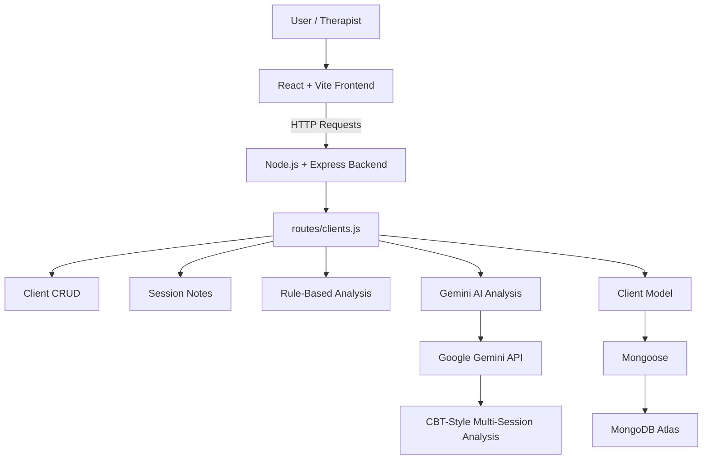

# CaseNote AI

CaseNote AI is a full-stack web application for managing therapy clients, storing session notes, and generating AI-powered CBT-style insights across multiple sessions.

## 🚀 Features

- Add, update, and delete clients
- Record multiple therapy session notes per client
- View session history
- Store client data and session notes in MongoDB
- Generate rule-based analysis from session notes
- Generate AI-based CBT-style analysis using Google Gemini API
- Analyze multiple sessions to identify patterns and changes over time
- Identify presenting concerns, automatic thoughts, emotions, behaviors, and possible core beliefs
- Suggest CBT-focused areas for future sessions

## 🧠 AI Integration

This project integrates **Google Gemini AI** to analyze therapy session notes and generate structured insights such as:

- Presenting concerns
- Automatic thoughts
- Emotions
- Behavioral patterns
- Possible core beliefs
- Cognitive distortions
- Suggested CBT focus
- Multi-session pattern recognition

The AI is used as an analysis assistant and does not replace therapist judgment or clinical decision-making.

## 🛠 Tech Stack

- **Frontend:** React + Vite
- **Backend:** Node.js + Express
- **API:** REST
- **Database:** MongoDB Atlas
- **ODM:** Mongoose
- **AI:** Google Gemini API
- **Environment Management:** dotenv
- **Frontend / Backend Communication:** Fetch API + CORS

## 🏗 Project Architecture



## 📁 Project Structure

```text
casenote-ai/
│
├── frontend/
│   ├── public/
│   ├── src/
│   │   ├── App.jsx
│   │   ├── App.css
│   │   ├── index.css
│   │   └── main.jsx
│   ├── index.html
│   ├── package.json
│   └── vite.config.js
│
├── models/
│   └── Client.js
│
├── routes/
│   └── clients.js
│
├── server.js
├── .gitignore
├── package.json
├── package-lock.json
└── README.md
```

## 🔄 Application Flow

```text
Therapist
   ↓
React Frontend
   ↓
Express REST API
   ↓
Mongoose
   ↓
MongoDB Atlas
```

For AI analysis:

```text
Session Notes
   ↓
Express Backend
   ↓
Gemini API
   ↓
Structured CBT Analysis
   ↓
Displayed in React Frontend
```

## 🗄 Data Model

Each client document can contain:

- Name
- Age
- Presenting issue
- Therapist ID
- Session notes
- Rule-based analysis
- Gemini analysis
- Created timestamp
- Updated timestamp

MongoDB automatically generates a unique `_id` for each client document.

## 🔐 Environment Variables

Create a `.env` file in the project root and add:

```env
GEMINI_API_KEY=your_gemini_api_key
MONGODB_URI=your_mongodb_connection_string
```

The `.env` file is excluded from Git using `.gitignore` and should never be committed to GitHub.

## ▶️ Running the Project Locally

### Backend

From the project root:

```bash
npm install
node server.js
```

The backend runs on:

```text
http://localhost:3000
```

### Frontend

Open a second terminal:

```bash
cd frontend
npm install
npm run dev
```

The frontend usually runs on:

```text
http://localhost:5173
```

## 🎯 Purpose

This project demonstrates:

- Full-stack web development
- React UI development
- REST API design
- Node.js and Express backend development
- MongoDB integration
- Mongoose data modeling
- CRUD operations
- AI API integration
- Multi-session data analysis
- Environment variable management
- Mental health technology prototyping

## ⚠️ Disclaimer

This application is intended for educational and portfolio purposes only.

It uses mock or test data and is not intended for real clinical use without appropriate security, privacy, authentication, authorization, regulatory compliance, clinical review, and organizational approval.